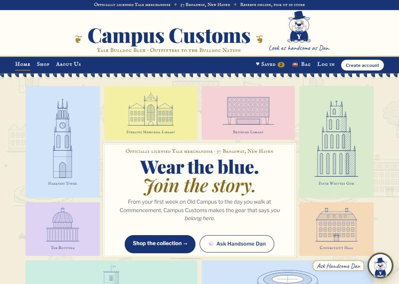
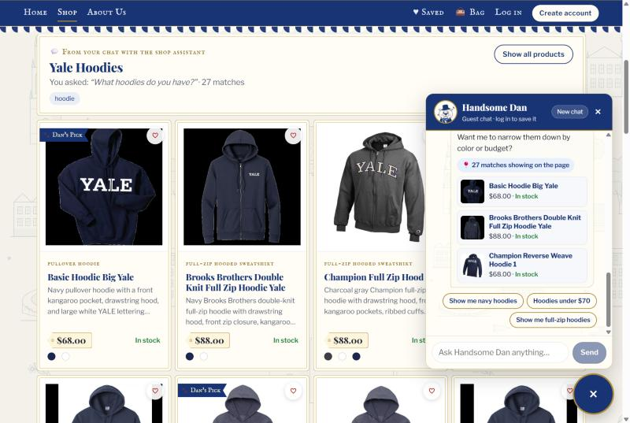

# Handsome Dan's Atelier 🎩🐾

**Campus Customs** (*Yale Bulldog Blue*): a web shop for officially licensed Yale apparel, with **Handsome Dan**, a PydanticAI shopping assistant, as host. It's built with React + Vite + TypeScript and FastAPI. HW 4.

**All the code is in [`hw4/`](hw4/).** Start with **[`hw4/README.md`](hw4/README.md)**: the file layout, how to place the data pack, and how to run the back end and front end, with a full screenshot gallery.

**🔎 Live-site check (opens as a web page):** https://sophiaruilin.github.io/handsome-dans-atelier/hw4/output/app_check.html

<table>
  <tr>
    <td width="50%"> <b>Home:</b> Handsome Dan under the title, with Yale landmarks as Victorian engravings.</td>
    <td width="50%"> <b>Chat search fills the page:</b> ask Dan for hoodies and all 27 appear as cards.</td>
  </tr>
</table>

| Read more | |
|---|---|
| [`hw4/output/harness.md`](hw4/output/harness.md) | How the system works: architecture, specs, the agent's tools, models, safety rules, audit trail |
| [`hw4/output/design.md`](hw4/output/design.md) | The storefront design, Handsome Dan, Seasonal Dan, the telegram receipt |
| [`hw4/output/usability.md`](hw4/output/usability.md) | Usability improvements (front end and agent) |
| [`hw4/AI_prompts.md`](hw4/AI_prompts.md) | The prompts used for each problem |

*The product database and product photos (the data pack) and API keys are intentionally not in this repository. See [`hw4/README.md`](hw4/README.md#1-place-the-data-pack).*
