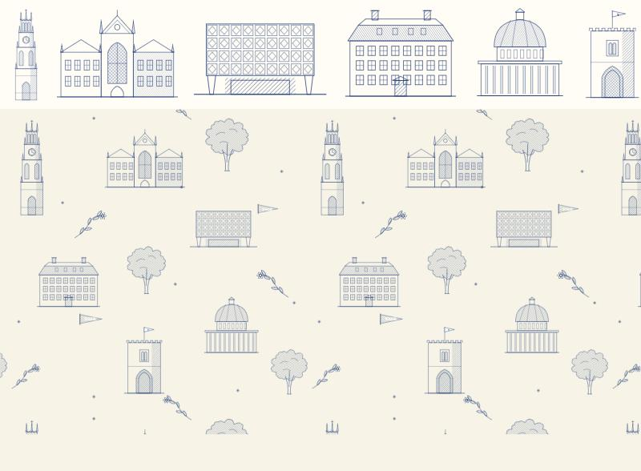
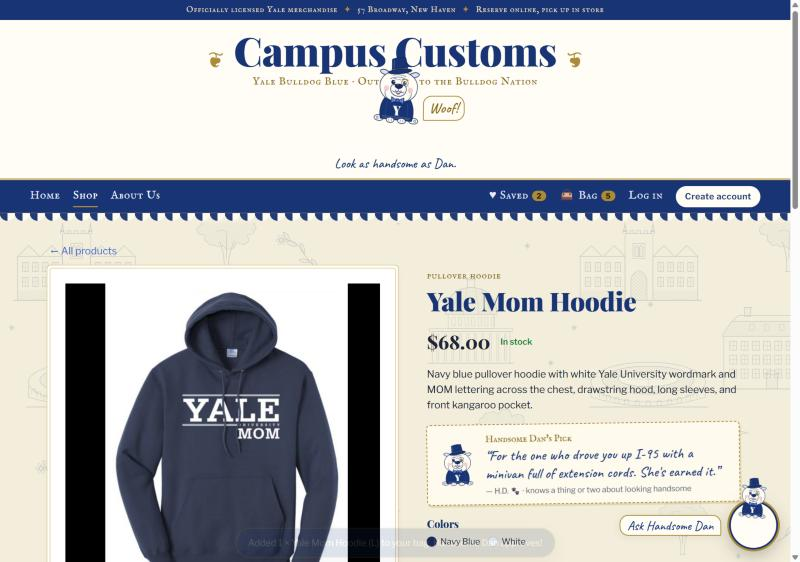
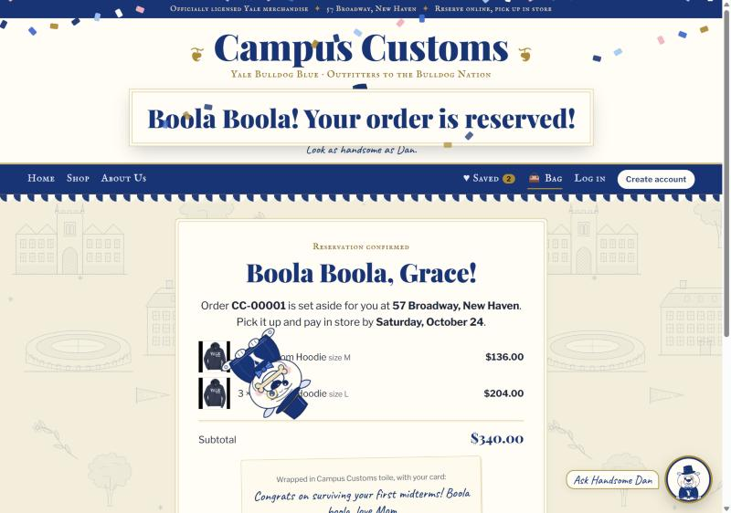
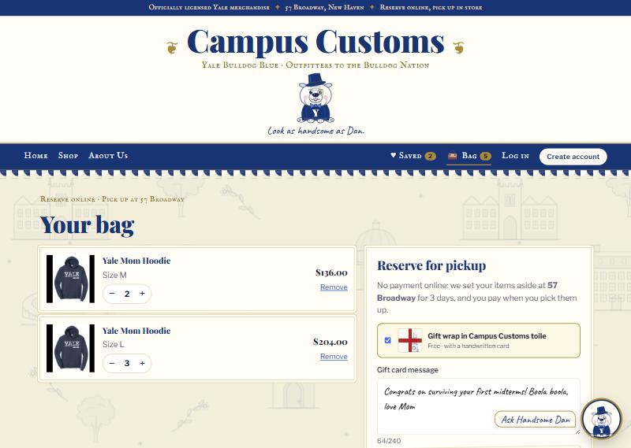
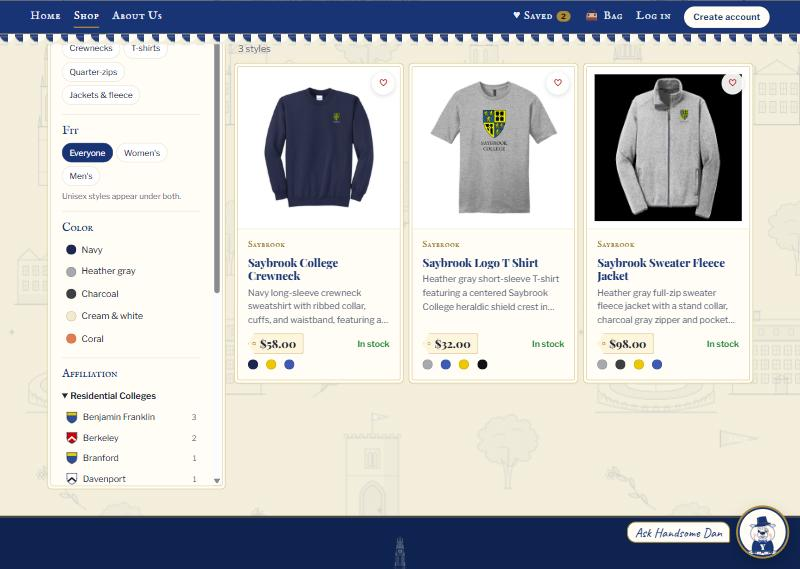
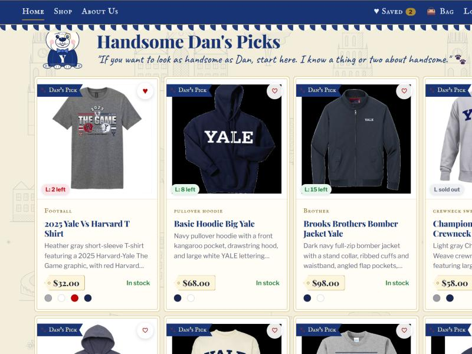
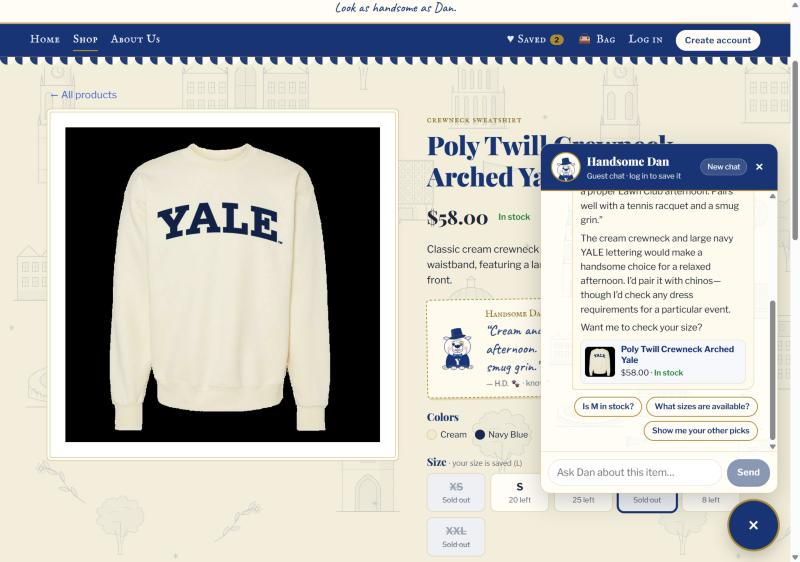
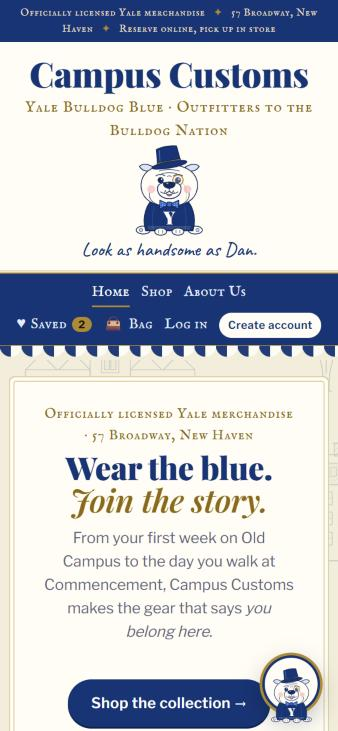

# Campus Customs: storefront design (Problem 10)

**The idea:** a New Haven outfitter with the polish of the **Yale Club of New York City** and the preppy ease of the **New Haven Lawn Club** (navy, cream and brass; engraved frames; striped awnings), plus the playful Victorian engravings of **Trader Joe's**, with **Handsome Dan**, a dapper cartoon bulldog, as host. Every image on the site is an original drawing, made in code.

## 1. Brand system: fonts, color and hierarchy

| Element | Choice | Why |
|---|---|---|
| Headlines | **Playfair Display** 900 and italic | High-contrast Victorian serif with the authority of a club crest and the confidence of a storefront sign |
| Labels, nav and eyebrows | **IM Fell English SC** | Engraved-type small caps, like a 19th-century printed price card |
| Dan's voice | **Caveat** handwriting | His notes, the gift card and captions feel personally written |
| Body text | **Libre Franklin** | A clean, very readable sans for descriptions and forms |
| Palette | Yale blue `#00356b` · cream `#f4eedf` · ivory `#fffdf7` · brass `#b08d57` | Yale Club navy and brass on Lawn Club cream; red is reserved for urgency (selling fast) |

**Hierarchy:**
1. A navy strip of shop facts (officially licensed · 57 Broadway · reserve online, pick up in store).
2. A huge **Campus Customs** wordmark between brass ❦ ornaments.
3. **Handsome Dan directly under the title, like a logo**, captioned *"Look as handsome as Dan."*
4. The sticky navy nav with brass hairlines.
5. A scalloped **awning stripe**, like a Lawn Club tent.

Content sits in ivory panels with a **double brass "engraved frame"** (`--frame`), so every card, filter and checkout reads as one family.

## 2. Campus toile wallpaper

- `frontend/scripts/build_art.py` draws **10 Victorian line engravings**: Harkness Tower, Sterling Memorial Library, Beinecke, Connecticut Hall, the Rotunda, Phelps Gate, Payne Whitney Gym, a Gothic residential-college gate, the Yale Bowl and New Haven's elms. They're drawn in Yale blue line art with crosshatch and diagonal hatching, like a steel engraving.
- The same script assembles them, with toile sprigs, pennants and stars, into a **seamless 960×960 tile** (`public/art/toile.svg`). Motifs crossing an edge are redrawn on the opposite edge, so the pattern never shows a seam.
- The tile is the **site-wide background**: off-white cream with Yale-blue buildings, softened by a cream wash so text stays readable. It's also used inside the chat panel and as the **gift-wrap paper** swatch at checkout.
- The same engravings fill the **Trader Joe's-style hero**: pastel tiles (powder, butter, blush, sage, lavender, peach, mint), each holding a landmark, around a framed headline. They also appear on the Home highlight cards and in the footer.

## 3. Handsome Dan, the mascot (`components/Dan.tsx`)

An original cartoon **English bulldog in Victorian dress**:
- a top hat at a jaunty angle, with a brass band
- a brass **monocle on a chain**
- a polka-dot bow tie and a navy **Y sweater**
- rose ears, jowls and the famous underbite

He's drawn in the same ink line as the wallpaper. He appears in:

- **The masthead, under the title**, as the logo.
- **The chat:** the floating button is his face, with an *"Ask Handsome Dan"* speech label. His avatar sits in the chat header and beside every reply, and the typing indicator is 🐾 paw prints. The **agent itself speaks as Handsome Dan** (see §6).
- **Handsome Dan's Picks** (Home section, card ribbons and product-page note cards), the empty bag ("Handsome Dan is sitting here very patiently…") and the receipt.

### He jumps when something goes in the bag

- **Add to bag** fires a `jump` on Dan's event bus (`dan/danBus.ts`).
- The **masthead Dan** and the **chat-button Dan** squash, leap, wiggle and land (`@keyframes dan-jump`).
- A **"Woof!"** bubble pops up, the **Bag** count bumps, and a toast says *"Added 2 × Yale Mom Hoodie (M) to your bag. Handsome Dan approves!"*

### He cartwheels across the screen with a biscuit at checkout

When a reservation is placed, Dan (now holding a **dog-bone biscuit** in his mouth) **cartwheels across the whole screen**: 4 full rotations with a hop on each turn. Yale-blue, brass and pink confetti falls, and a framed banner reads **"Boola Boola! Your order is reserved!"** Everything respects `prefers-reduced-motion`.

## 4. Shopping: the bag, gift wrap and "reserve for pickup"

The shop takes no payments online, and our safety rules say the assistant never handles cards. So checkout **reserves the bag for pickup at 57 Broadway** (your choice):

- **Add to bag** on product pages has a quantity stepper capped at the stock left. The bag is kept in the browser.
- **Bag page:** line items with steppers, and **free toile gift wrap** shown as a toile swatch with a red ribbon. A **handwritten gift card** has a live preview in Caveat ("Congrats on surviving your first midterms! Boola boola, love Mom"). Name and email are pre-filled for logged-in shoppers.
- **`POST /api/orders`** (`backend/orders.py`):
  - **Re-reads every price from the catalogue**, never from the browser.
  - Checks stock and **takes it off the shelf**: the inventory goes down, so nobody else buys the last one while you're on the way. This happens inside one locked transaction (`BEGIN IMMEDIATE`), so two shoppers can't both reserve the last item, and a failure rolls back the whole order.
  - Saves the order in new `orders` and `order_items` tables, held for 3 days.
- **Receipt:** order number (`CC-00001`), pickup-by date, items, subtotal and the gift card. Logged-in shoppers can ask Dan about their reservations (`get_my_account` → `orders`).

**Verified:**
- Reserved 2 × M and 3 × L Yale Mom Hoodies with gift wrap. The database showed order 1 with the note and $340.00 at catalogue prices, and stock went from **M 8 → 6 and L 25 → 22**.
- Tests cover duplicate lines merging, over-ordering (the whole order rolls back) and sold-out sizes (`tests/test_storefront.py`, on a temporary copy of the database).
- The test order was then removed and the stock restored, so the committed database keeps the seed inventory.

## 5. Search by school, fit, color and style

The Shop page has a framed **filter sidebar**:

- **Style:** hoodies, crewnecks, t-shirts, quarter-zips, jackets and fleece.
- **Fit:** Everyone, Women's or Men's. **Unisex styles appear under both** (your choice).
  - The catalogue has no gender field, so `backend/catalog_meta.py` infers it from names and tags ("Men's", "Yale Mom", "Grandpa", "men's outerwear").
  - Result: 88 unisex, 10 men's and 4 women's → **Women's shows 92, Men's shows 98.**
- **Color:** five families by the garment's main color, with swatches: Navy 44, Heather gray, Charcoal, Cream & white, Coral.
- **Affiliation**, inspired by the shields in your reference images, in four groups with counts:
  - **Residential Colleges** (11: Benjamin Franklin … Trumbull) and **Graduate & Professional Schools** (11: Architecture, Art, Divinity, Engineering, Environment/Forest School, Law, Management, Medicine, Music, Nursing, Public Health). Each has a **small original shield** (`components/Shield.tsx`) whose colors and division (chevron, pale, saltire …) are *inspired by* that school's arms, not copies of the official marks.
  - **Varsity Teams** (16) and **For the Family** (Mom, Dad, Grandma, Grandpa, Aunt, Uncle, Brother, Cousin). That's a big one for parents.
- **🐾 Handsome Dan's Picks only**, active-filter chips with "Clear all", search, sort (Featured puts Dan's Picks first), and **My size** (from Problem 9).
- **Home → "Rep your residential college":** a row of shields, each linking to `/products?affiliation=…`.
- **The agent knows affiliations too:** "Anything for a Saybrook student?" returned exactly the 3 Saybrook products.

**Verified:**
- Saybrook → 3 styles. Family → Mom → 2 styles. Mom + Dan's Picks → the Yale Mom Hoodie.
- Fixed a false match ("**Brooks Brothers**" was being tagged *Brother*), with a test.

## 6. Handsome Dan's Picks, and the agent's voice

- **8 picks** with notes in Dan's voice (`catalog_meta.DAN_PICKS`). For example:
  - Yale Mom Hoodie: *"For the one who drove you up I-95 with a minivan full of extension cords. She's earned it."*
  - Poly Twill Crewneck: *"Cream and navy, like a proper Lawn Club afternoon. Pairs well with a tennis racquet and a smug grin."*
- Each pick shows a **"🐾 Dan's Pick" ribbon** on its card. The product page shows a tilted **paper note card** with Dan's portrait and the byline *"— H.D. 🐾 · knows a thing or two about looking handsome"*.
- **Home** has a *Handsome Dan's Picks* section: *"If you want to look as handsome as Dan, start here. I know a thing or two about handsome."*
- **Agent persona** (`prompts/prompt.md`): the assistant *is* Handsome Dan. He speaks in the first person, is a little vain about his looks, and uses at most one dog joke per reply ("accuracy first; charm second"). Tool results carry `dan_pick` and `dan_note`, so he can say "one of my personal picks!" and quote himself. He also explains how to buy: Add to bag → Bag → Reserve for pickup, pay in store.

**Verified (live agent):**
- "Who are you? And what would you pick for my mom?" → *"I'm Handsome Dan… the good looks come with the job"*, recommending the Yale Mom Hoodie as *"one of my personal picks."*
- On the Brooks Brothers jacket: "How do I buy this? Can I pay here?" → the three reserve-and-pickup steps, and correct sizes in stock (XS, L, XXL).
- On the Poly Twill Crewneck: "Is this one of your picks?" → quotes his Lawn Club note word for word.

## 7. Motion, product presentation and polish

- **Cards:** framed, with a **brass hang-tag price** (punched hole and notched edge), Dan's ribbon, affiliation eyebrow, color swatches, hearts and "My size" badges. They lift on hover.
- **Hero tiles** tilt slightly on hover; the masthead Dan tips his hat (rotates) on hover; the "Ask Handsome Dan" label gives a little nudge every few seconds; chat cards and quick replies pop in.
- **Product page:** framed photo, Dan's note card, size buttons, a quantity stepper, a **brass "Add to bag · $68.00" button** and "2 in your bag · Reserve for pickup →".
- **Footer:** an inverted engraving of Harkness Tower and *"Lux et Veritas, and a really good hoodie."*
- **Mobile:** the hero tiles collapse to two columns, the filters and checkout stack, and the nav compacts.

## Data notes

- Three seed products (`benjamin-franklin-t-shirt`, `berkeley-sweater-fleece-jacket`, `timothy-dwight-college-crewneck`) have **no colors and a placeholder description** in the database. They show up in every filter except Color, and the site handles the empty color list safely.
- The `orders` and `order_items` tables are created on first use, so the seed database needs no migration.

## Two-minute tour

1. **Home:** Dan under the title, pastel engraving tiles, Dan's Picks, college shields → click **Saybrook**.
2. **Shop:** try Fit → Women's, Color → Navy, Affiliation → Family → Mom, and 🐾 Dan's Picks only.
3. Open the **Yale Mom Hoodie** → read Dan's note → pick **M** → **Add to bag** (watch Dan jump and say "Woof!").
4. **Bag** → tick **toile gift wrap**, write a card → **Reserve for pickup** (watch the cartwheel).
5. Click **Ask Handsome Dan** → *"What would you pick for my mom?"*
