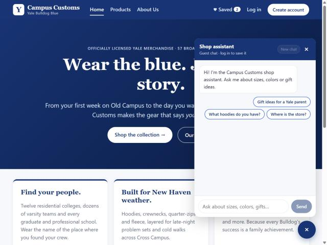
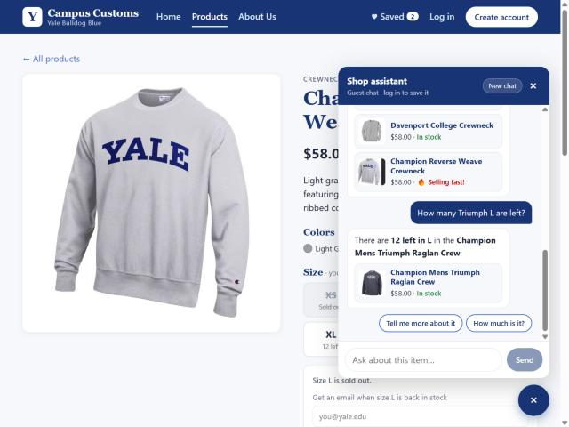
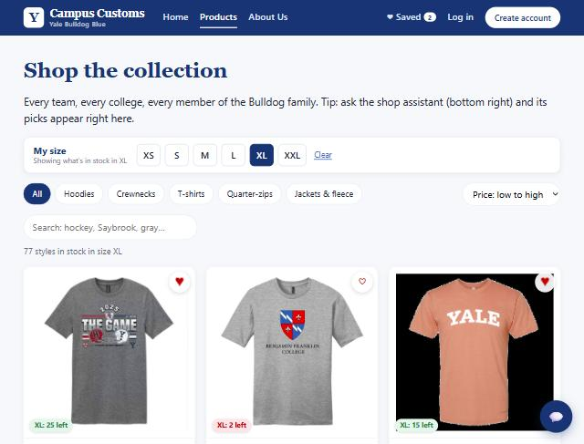
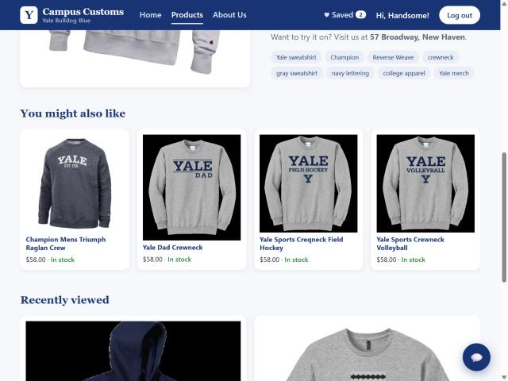
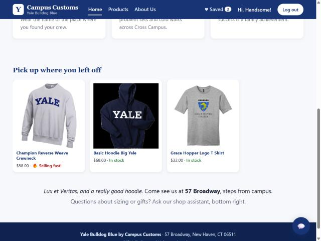
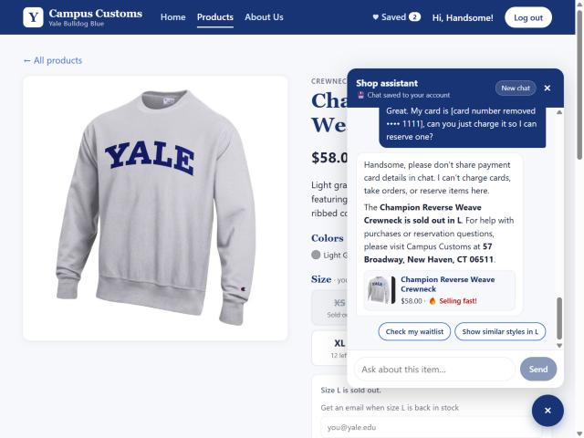

# Campus Customs: usability improvements (Problem 9)

The assignment asked for 2 front-end and 2 agent/back-end improvements. **I built 4 of each.** Each one fixes a *different* moment where a real Campus Customs shopper would get stuck, or where the shop would lose a sale. Stopping at two would have left an obvious gap in the shopping journey:

> **find** (quick replies, my size and sort) → **decide** (saved items, similar styles) → **ask** (faster, fact-checked answers) → **don't lose the sale** (chat waitlist) → **stay safe** (card-number masking)

Every feature below is live in the running app. The "Where to see it" lines are a tour for graders, and the screenshots in `output/screenshots/` were taken from the running site.

| # | Improvement | Type | Helps the shopper | Helps the business |
|---|---|---|---|---|
| F1 | Chat quick replies (page starters + agent follow-ups) | Front end | No blank-box anxiety; one tap to ask | More chats that turn into product views |
| F2 | "My size" filter + sorting | Front end | Only see what you can actually buy | Fewer dead-end clicks on sold-out styles |
| F3 | Saved items ♥ with nav counter and Saved page | Front end | Shortlist gifts while deciding | Keeps intent alive across visits |
| F4 | "You might also like" + "Recently viewed" | Front end | Easy alternatives and a way back | Cross-sells and recovers browsing sessions |
| B1 | Faster, cheaper product-page answers + usage log | Back end | Answers in about 2.4 s instead of about 5.3 s | About 40% fewer tokens per question; cost is measurable |
| B2 | New tools: `find_similar_products`, `join_waitlist` | Agent | "Sold out" becomes "here's what you *can* get" | Captures demand for restocks |
| B3 | Price fact-checker (output validator) | Agent | Never told a wrong price | Protects trust and avoids price disputes |
| B4 | Card-number masking | Back end | Protected even when they over-share | Card data never stored or sent to the AI provider |

---

## Front-end improvements

### F1. Chat quick replies: page starters and agent-written follow-ups

**What I added**
- **Before the first message:** one-tap **starter questions that fit the page**.
  - Home: "Gift ideas for a Yale parent", "What hoodies do you have?", "Where is the store?"
  - Products: "Navy crewnecks under $60", "What's selling fast?"
  - A product page: "What sizes are left?", "Show me similar styles", "Does this come in gray?"
- **After every reply:** the agent suggests **2–3 follow-ups written as the shopper**, such as "How many Triumph L are left?" or "Check my waitlist". This uses a new `suggested_replies` field in the agent's structured output (`ShopReply`), sent to the site as `ChatResponse.suggestions`, and the buttons send with one tap.
- **"💬 Ask about this item"** on every product page opens the chat with a ready-made question. If the selected size is sold out, it asks for similar styles in that size.
- An animated "typing" indicator replaces the plain "Looking that up…" text.

**Why it helps**
- Many shoppers, especially parents shopping for a student, don't know what the assistant can do. Starters show them in one glance.
- Follow-ups keep the conversation moving toward a product.
- One-tap replies also help on phones, where typing is slow.

**Where to see it:** open the chat (bottom right) on any page. Ask anything, then tap one of the blue follow-up buttons. On a product page, click **💬 Ask about this item**.

**Verified:** on the Champion Reverse Weave Crewneck page I selected size L (sold out) and clicked *Ask about this item*. The chat opened with "Size L is sold out. What similar styles do you have in L?". The agent replied with three in-stock L crewnecks, plus follow-ups including "How many Triumph L are left?". Tapping that follow-up sent it, and the reply ("12 left in L") matches the database exactly.

---

### F2. "My size" filter and sorting on Products

**What I added**
- **A "My size" bar** (XS–XXL) at the top of Products. Pick a size and:
  - the grid shows **only styles in stock in that size** (for example "77 styles in stock in size XL"; the database confirms exactly 77)
  - every card gets a badge: **"XL: 25 left"** in green, **"XL: 2 left"** in red for selling fast, or **"XL sold out"**
  - the badges also appear on chat search results and on the Saved page
- **The size is remembered** (in this browser) and **pre-selected on every product page**. Choosing a size on a product page updates it.
- **Sort:** Featured, Price low to high, Price high to low, Selling fast first, Name A–Z.

**Why it helps**
- Nothing is more frustrating than falling for a hoodie and finding your size gone. With 145 of 612 size slots sold out, that happened a lot.
- Shoppers now see only what they can buy, and gift-givers on a budget can sort by price.
- **For the business:** fewer frustrated exits, and "Selling fast first" adds urgency.

**Where to see it:** Products → click **XL** in the *My size* bar → open the sort menu → **Price: low to high**. Then open any product: your size is already selected.

---

### F3. Saved items (♥)

**What I added**
- **A heart on every product card** and a **♥ Save** button on product pages.
- **"♥ Saved"** in the nav bar with a live **counter badge**.
- **A Saved page** (`/saved`) listing the saved styles with live price and stock, including the "My size" badges.
- Saved items are kept in the browser, so **guests can use it too**, with no account needed.

**Why it helps**
- Gift shopping for a student, a dad and a grandparent means comparing options across sessions. A shortlist keeps buying intent alive instead of losing it to a closed tab.

**Where to see it:** tap the ♡ on any card. The nav counter goes up. Click **♥ Saved** in the nav.

**Verified:** after saving two t-shirts, the nav showed "Saved 2", and `/saved` listed both with "L: 2 left" and "L sold out" badges (after size L was chosen).

---

### F4. "You might also like" and "Recently viewed"

**What I added**
- **"You might also like"** on every product page: 4 in-stock styles of the same kind and theme at a similar price. It comes from a new endpoint, `GET /api/products/{id}/similar`, which uses the **same logic as the agent's new `find_similar_products` tool** (B2), so the site and the chat always agree.
- **"Recently viewed"** on product pages, and **"Pick up where you left off"** on the Home page.

**Why it helps**
- Every product page used to be a dead end, especially when a size was sold out. Now there's always a next step.
- Returning shoppers land right back on what they were considering.
- **For the business:** cross-selling and session recovery, which are standard levers in e-commerce.

**Where to see it:** open any product and scroll down. Then go to **Home** to see "Pick up where you left off".

**Verified:** Champion Reverse Weave Crewneck suggested 4 in-stock crewnecks (Champion Mens Triumph Raglan Crew, Yale Dad Crewneck, …). Home listed the 3 products viewed most recently.

---

## Agent / back-end improvements

### B1. Faster, cheaper answers on product pages, and a usage log

**What I measured first**
- Loading the whole catalogue takes **2.6 ms**, so a cache would save only about 13 ms per chat. Not worth adding.
- **Reasoning effort** isn't a lever: `gpt-6-astra` already uses 0 reasoning tokens, and "minimal" and "none" are rejected.
- The real cost was **round trips to the model**. Each request sends about 5,000 input tokens, and "Do you have this in XS?" took **2 requests**: one to call `check_stock`, then one to answer.

**What I added**
- **The product page context now includes live stock**, read from the database for every message. For example: *"Live stock: XS SOLD OUT, S SOLD OUT, M 12 left, L SOLD OUT, XL 12 left, XXL SOLD OUT"*. The agent answers price and size questions about the product you're viewing **in a single model request**. The numbers are still straight from the database, never guessed.
- **A per-turn usage log** (`backend/logs/chat_usage.jsonl`, kept out of git). Each line records time, model requests, input and output tokens, tools used, price corrections, and guest or logged-in. **No message text is logged**, for privacy.

**Results** (same questions, product pages, measured from the log)

| Question on a product page | Before | After |
|---|---|---|
| "Do you have this in XS?" (simple stock question) | 2 requests · ~5,100 input tokens · 5.3 s | **1 request · ~3,100 tokens · 2.4 s** |
| "How many are left in M?" | 2 requests (check_stock) | **1 request · 3,100 tokens · 2.4 s** (answer correct: 5 left) |
| "What's the price?" | 2 requests (get_product_info) | **1 request · 3,094 tokens · 2.5 s** (answer correct: $58.00) |

That's about **55% faster and about 40% cheaper** for the most common product-page questions.

**Why it helps:** shoppers get answers in about half the time, and the business pays for about 40% fewer tokens. The log lets the shop track cost and speed over time instead of guessing.

---

### B2. Two new agent tools: `find_similar_products` and `join_waitlist`

**What I added**
- **`find_similar_products(product_id, color, max_price, size)`:** in-stock alternatives, ranked by:
  - the same garment category
  - shared themes (tags)
  - the same main color
  - a similar price

  It can be filtered to a color, a budget, or **a size that's in stock**. Shared with the product page (F4).
- **`join_waitlist(product_id, size)`:** for **logged-in** shoppers, it adds them to the back-in-stock list using the email on their account.
  - It refuses sizes that are actually in stock ("no waitlist needed") and sizes we don't make.
  - Guests are pointed to the form on the product page.
  - The website's waitlist form and this tool now share one function (`tools.add_to_waitlist`).
- **Prompt rule:** when a size is sold out, offer **both** the waitlist and similar styles in their size. Only join the waitlist when the shopper says yes.

**Why it helps:** before, "sold out" ended the conversation. Now it leads to a **sale** (an alternative in their size) or a **lead** (a waitlist email the shop can use when it restocks).

**Verified (as Handsome Dan, logged in):**

> **Dan:** "Size L is sold out. Please add me to the waitlist for L."
> **Agent:** "You're on the list, Handsome! We'll email you when the Champion Reverse Weave Crewneck in L is back in stock."

`waitlist.db` now holds `champion-reverse-weave-crewneck · L · handsome.dan@campuscustoms.yale.edu`. The agent offered "Check my waitlist" as a follow-up, which `get_my_account` answers.

---

### B3. Price fact-checker: the agent can't quote a price it didn't look up

**What I added**
- **A PydanticAI output validator** (`check_prices` in `agent.py`) that runs on every reply before it reaches the shopper:
  - Every tool records the prices it returns in the run's deps (`known_prices`). That includes search, product info, stock checks, similar products and the page context.
  - The validator pulls every `$` amount out of the reply. If any amount is neither a price a tool returned nor a number the shopper typed (such as their "$60" budget), it raises `ModelRetry`. The model must then look up the price or remove it.
  - The agent gets up to 2 retries. If it still can't produce a clean answer, the shopper sees "Sorry, I couldn't double-check that answer" instead of a wrong price.

**Why it helps:**
- A made-up price is the most damaging mistake a shop chatbot can make. It breaks trust, and it can create a "but your assistant said $49.99" dispute at the register.
- Problem 6's prompt rules *ask* the model not to invent prices; **this makes it a guarantee, checked in code**.

**Verified:**
- Unit tests (`tests/test_improvements.py`):
  - a reply with real prices plus the shopper's own budget passes
  - "It's on sale for $49.99 today!" is rejected with a retry naming `$49.99`
- Live: 0 corrections were needed across the test chats (see the usage log), which shows the tools-first rules from Problem 6 already work. The checker is the safety net for the time they don't.

---

### B4. Card-number masking

**What I added**
- Before a message reaches the AI model, the database or the logs, the back end looks for anything shaped like a payment card number: 13–19 digits **that pass the Luhn checksum**, so phone and order numbers are left alone.
- A match is replaced with `[card number removed •••• 1111]`.
- The shopper's own chat bubble is updated to the masked version too (`ChatResponse.redacted_message`), so they can see it was protected.

**Why it helps:**
- Shoppers do paste card numbers into chats ("can you just charge it?").
- **For the business:** card data is never stored in its database or sent to a third-party AI provider. That's a real PCI-compliance and liability risk avoided.
- The agent still politely explains it can't take payments, as required by the safety rules from Problem 5.

**Verified:** Dan typed "My card is 4111 1111 1111 1111, can you just charge it…".
- The bubble changed to "[card number removed •••• 1111]".
- The agent replied "please don't share payment card details in chat…".
- The database search for "4111 1111" returns **0 rows**, and the saved message holds only the masked text.

---

## Tests

`backend/tests/` now has **31 tests, all passing** (`python -m pytest -q` in `backend/`). That's 21 from Problems 6–7 plus 10 new ones for similar products, waitlist rules, card masking (including phone and order numbers that must *not* be masked) and the price fact-checker.

## Two-minute grader tour

1. **Home:** open the chat → see the **starter buttons** (F1). Scroll down → **"Pick up where you left off"** appears after you've viewed a few products (F4).
2. **Products:** click **XL** in *My size* → the grid filters with "XL: N left" badges. Sort by **Price: low to high** (F2). Tap a few **♡** hearts → the nav **♥ Saved** counter goes up (F3).
3. **Open a product:** your size is pre-selected. Pick a sold-out size → click **💬 Ask about this item** (F1). The agent suggests in-stock alternatives in your size (B2), quickly and with checked prices (B1, B3). Tap a follow-up button.
4. **Scroll down** on the product page → **You might also like** and **Recently viewed** (F4).
5. **Log in** (`test@campuscustoms.yale.edu` / `password`) → on a sold-out size, ask *"add me to the waitlist"* (B2). Then type a test card number such as `4111 1111 1111 1111` → it's masked (B4).
6. **Saved page:** ♥ Saved in the nav (F3).
